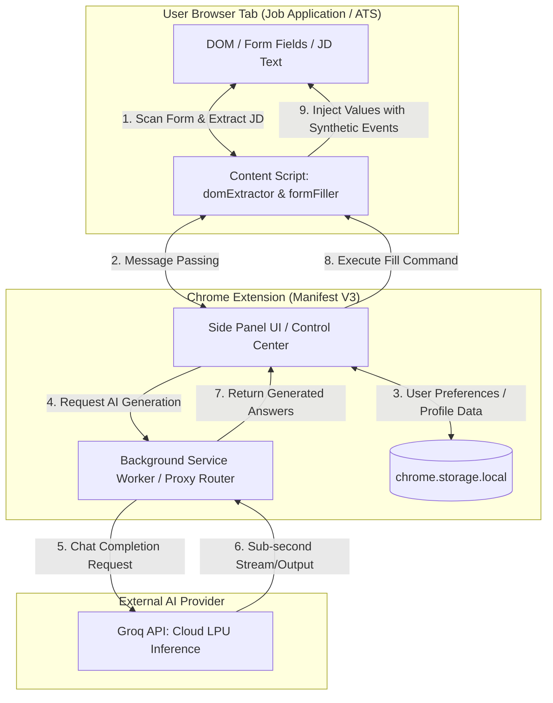

# AGENT.md — JobHunt AI AutoFiller Master Guide

> **Agent Operating Directive & Architecture Specification**  
> **Status:** 🟢 **ACTIVE GREENFIELD / SCAFFOLDING IN-PROGRESS (Phase 1)**  
> **Last Verified:** 2026-11-10  
> **Target Standard:** Chrome Extension Manifest V3 (MV3)  
> **Core Engine:** Groq API Cloud LPU Inference + Native Chrome Side Panel (`chrome.sidePanel`)

---

> [!IMPORTANT]
> **GREENFIELD PROJECT STATUS NOTICE FOR AI AGENTS**  
> This project is currently in **Phase 1 (Scaffolding & Core Architecture Setup)**.  
> As an agent working in this repo:
> 1. Always inspect the filesystem using `Get-ChildItem` or directory tools before attempting edits.
> 2. Refer to the **Component Status Matrix** in Section 4 to see which files are fully scaffolded, under active construction, or planned.
> 3. Never assume legacy code exists or invent undocumented internal libraries.

---

## 1. AGENT.md Maintenance Contract & Drift Prevention

To prevent documentation drift as this codebase evolves:
- **Mandatory Update Rule:** Any agent or engineer who modifies the architecture, adds/renames/removes source files, adjusts storage schemas, or changes dependency configurations **MUST** update `AGENT.md` in the exact same turn or pull request.
- **Verification Requirement:** Whenever a new component is completed, update its status in Section 4 from `Planned` or `In-Progress` to `Scaffolded` or `Active`.
- **Review Trigger:** If you discover a discrepancy between `AGENT.md` and disk, resolve the discrepancy immediately before writing new features.

---

## 2. Core Agent Principles & Operating Rules

### A. Chrome Extension Manifest V3 Compliance
- **Zero V2 APIs:** Never use `chrome.browserAction`, `background.scripts`, or `chrome.tabs.executeScript`. Use `chrome.action`, `background.service_worker`, and `chrome.scripting.executeScript`.
- **Ephemeral Background Workers:** The service worker (`src/background/service-worker.ts`) shuts down after ~30 seconds of inactivity. **Never store state in in-memory global variables.** Always persist state in `chrome.storage.local` or `chrome.storage.session`.
- **Strict Content Security Policy (CSP):** No `eval()`, no `new Function()`, no remote script loading, no inline scripts (`<script>code</script>`), and no inline HTML event handlers (`onclick="..."`).
- **Async/Await Only:** Never use `.then()` chains.
- **Message Passing Protocol:** For any asynchronous `chrome.runtime.onMessage.addListener`, return `true` synchronously to hold the message channel open.
- **Side Panel Triggering:** Use `chrome.sidePanel.setPanelBehavior({ openPanelOnActionClick: true })` inside the service worker. (Note: It is `openPanelOnActionClick`, NOT `openPanelOnActionIconClick` which throws a synchronous TypeError).

### B. Security & API Key Egress Scoping
- **Strict Host Permission Scoping:** Host permissions in `manifest.json` are strictly scoped to:
  ```json
  "host_permissions": [
    "https://api.groq.com/*",
    "https://*.greenhouse.io/*",
    "https://*.lever.co/*",
    "https://*.ashbyhq.com/*",
    "https://*.myworkdayjobs.com/*",
    "https://*.linkedin.com/*",
    "https://*.indeed.com/*",
    "https://*.huntingcube.ai/*",
    "https://huntingcube.ai/*"
  ]
  ```
- **Universal ATS Dynamic Injection:** Uses `activeTab` + `scripting` API to dynamically inject `content.js` when users trigger analysis on new or unlisted job portals.
- **API Key Lifecycle & Protection:**
  - Store the user's Groq API key strictly in sandboxed `chrome.storage.local`.
  - Keys are sent **only** as `Authorization: Bearer <KEY>` headers directly to `https://api.groq.com/*`.
  - **Zero Telemetry / Zero Logging:** Never print the API key to `console.log`, crash telemetry, or error messages. Mask keys in UI (`gsk_••••••••`).
  - **Invalid / Compromised Key Handling:** If Groq returns `HTTP 401 Unauthorized`, notify the user in the Side Panel, flag the key as invalid, and prompt for re-entry. Never retry indefinitely on 401.

### C. Storage Limits & Quota Management
- `chrome.storage.local` has a standard Chrome quota of ~10MB (`QUOTA_BYTES = 10,485,760`).
- To prevent quota overflow when users save multiple lengthy resumes or large application histories:
  1. Store raw resume text with boilerplate (whitespace, duplicate headers) stripped.
  2. For large portfolios/resumes, declare `"unlimitedStorage"` in `manifest.json` if storage exceeds 5MB.
  3. Monitor storage usage via `chrome.storage.local.getBytesInUse()` during profile updates.

### D. Groq Model Versioning & Retirement Resilience
- Groq periodically decommissions older model IDs (e.g., `llama-3-70b-8192` deprecated in favor of `llama-3.3-70b-versatile`).
- **Resilience Protocol:**
  - Use a centralized model registry (`src/shared/constants.ts`) with a structured fallback sequence:
    ```typescript
    export const GROQ_MODELS = {
      ESSAY_PRIMARY: 'llama-3.3-70b-versatile',
      ESSAY_FALLBACK: 'llama-3.1-70b-versatile',
      FAST_CLASSIFICATION: 'llama-3.3-70b-versatile',
    } as const;
    ```
  - If an API call fails with `model_decommissioned` or HTTP 404, the client must automatically attempt the fallback model and notify the user in the Side Panel settings to update their preferred model.

### E. DOM Injection & Reactive Framework Compatibility
- Modern ATS applications (Greenhouse, Lever, Ashby, Workday) build their forms using React, Angular, or Vue. Setting `element.value = "text"` will be erased on submit because internal framework state trackers don't fire.
- **Mandatory Setter & Event Dispatch Sequence:**
  ```typescript
  // 1. Focus element
  element.focus();
  // 2. Access native prototype setter to bypass React's synthetic input tracker
  const prototype = element instanceof HTMLInputElement 
    ? window.HTMLInputElement.prototype 
    : window.HTMLTextAreaElement.prototype;
  const nativeValueSetter = Object.getOwnPropertyDescriptor(prototype, 'value')?.set;
  nativeValueSetter?.call(element, value);
  // 3. Update React 16+ _valueTracker
  const tracker = (element as any)._valueTracker;
  tracker?.setValue(value);
  // 4. Dispatch synthetic bubbling events
  element.dispatchEvent(new Event('input', { bubbles: true }));
  element.dispatchEvent(new Event('change', { bubbles: true }));
  element.dispatchEvent(new Event('blur', { bubbles: true }));
  ```
- **Human-in-the-Loop Safety:** The extension autofills and highlights fields (light green pulse). It **never** clicks the final "Submit Application" button automatically.

---

## 3. System Architecture Diagram



---

## 4. Component Status Matrix & File Map

| File / Component | Status | Purpose / Responsibility |
| :--- | :---: | :--- |
| `manifest.json` | 🟢 **Active & Verified** | Extension definition, MV3 permissions, host permissions, side panel entry. |
| `.env.example` | 🟢 **Active & Verified** | Environment variable template (Groq API key & Google OAuth Client ID). |
| `.gitignore` | 🟢 **Active & Verified** | Git exclusion list protecting `.env`, secrets, node_modules, and dist. |
| `package.json` | 🟢 **Active & Verified** | Dependencies (Vite, TypeScript, Tailwind, Lucide, Chrome types). |
| `tsconfig.json` | 🟢 **Active & Verified** | Strict TypeScript compiler configuration. |
| `vite.config.ts` | 🟢 **Active & Verified** | Multi-entry build configuration for Extension components. |
| `icons/` | 🟢 **Active & Verified** | Generated icon assets (16, 32, 48, 128px). |
| `scripts/package.js` | 🟢 **Active & Verified** | Cross-platform zip archiver for Chrome Web Store distribution packages. |
| `src/shared/types.ts` | 🟢 **Active & Verified** | TypeScript types for messages, profiles, fields, and Groq responses. |
| `src/shared/constants.ts` | 🟢 **Active & Verified** | Groq model identifiers, fallback lists, ATS selector maps, Google Form entry IDs & feedback URL builder. |
| `src/background/service-worker.ts`| 🟢 **Active & Verified** | Ephemeral service worker, Groq API gateway proxy, side panel opener, and uninstall feedback URL handler. |
| `src/content/content.ts` | 🟢 **Active & Verified** | Content script entry point & message listener. |
| `src/content/jd-scraper.ts` | 🟢 **Active & Verified** | Job Description extraction from Greenhouse, Lever, Ashby, and general DOM. |
| `src/content/form-detector.ts` | 🟢 **Active & Verified** | Form input detection and label resolution cascade. |
| `src/content/dom-injector.ts` | 🟢 **Active & Verified** | React-safe native value setter, radio/checkbox/select injector. |
| `src/sidepanel/index.html` | 🟢 **Active & Verified** | Clean modern HTML layout for the Side Panel. |
| `src/sidepanel/sidepanel.ts` | 🟢 **Active & Verified** | Side Panel state management, tabs (Profile, Fill, Settings). |
| `src/sidepanel/sidepanel.css`| 🟢 **Active & Verified** | Modern styling with dark/light theme support. |
| `src/core/ai/groq-client.ts` | 🟢 **Active & Verified** | Groq REST API client with model fallback & error handling. |
| `src/core/ai/prompts.ts` | 🟢 **Active & Verified** | Prompt templates for JD analysis, custom essay answers & AI resume parser. |
| `src/core/profile/schema.ts` | 🟢 **Active & Verified** | Validation schema for Candidate Profile & Settings. |
| `src/core/profile/storage.ts` | 🟢 **Active & Verified** | Local storage manager with quota safety check. |
| `src/core/auth/google-auth.ts` | 🟢 **Active & Verified** | Native Google 1-click authentication via `chrome.identity.launchWebAuthFlow`. |
| `tests/auth.test.ts` | 🟢 **Active & Verified** | Vitest unit tests for Google Auth session and storage lifecycle. |
| `CHROMEWEBSTORE.md` | 🟢 **Active & Verified** | Single source of truth for Chrome Web Store publishing metadata. |
| `docs/index.html` | 🟢 **Active & Verified** | SEO-optimized, unslop-crafted landing page ready for 1-click GitHub Pages hosting. |

---

## 5. Data Schemas

### 5.1 User Profile Schema (`UserProfile`)
Stored in `chrome.storage.local.profile`:
```typescript
export interface UserProfile {
  personal: {
    fullName: string;
    firstName: string;
    lastName: string;
    email: string;
    phone: string;
    location: string;
    linkedinUrl: string;
    githubUrl: string;
    portfolioUrl: string;
  };
  workAuthorization: {
    authorizedInCountry: boolean;
    requiresSponsorship: boolean;
    visaStatus?: string;
  };
  experienceSummary: string; // Condensed elevator pitch
  resumeText: string;        // Full raw text of candidate's resume
  skills: string[];          // List of core technical & soft skills
  workHistory: Array<{
    company: string;
    role: string;
    startDate: string;
    endDate: string;
    highlights: string[];
  }>;
  customQAOverrides: Record<string, string>; // User-defined answers for specific prompts
}
```

### 5.2 Groq Settings Schema
Stored in `chrome.storage.local.settings`:
```typescript
export interface ExtensionSettings {
  groqApiKey: string;
  preferredModel: string;
  temperature: number; // Default: 0.3
  autoDetectFields: boolean;
  highlightFilledFields: boolean;
}
```

### 5.3 Authenticated User Schema (`AuthUser`)
Stored in `chrome.storage.local.auth_user`:
```typescript
export interface AuthUser {
  id: string;              // Google sub ID
  email: string;
  name: string;
  givenName?: string;
  familyName?: string;
  picture?: string;
  token: string;           // OAuth access token
  authenticatedAt: number; // Unix timestamp
}
```

### 5.4 Detected Field Schema
```typescript
export interface FormField {
  id: string;              // Unique selector or generated UUID
  name: string;            // DOM element name or id
  type: 'text' | 'textarea' | 'select' | 'radio' | 'checkbox' | 'email' | 'tel';
  label: string;           // Extracted label from <label>, aria-label, or placeholder
  placeholder?: string;
  required: boolean;
  currentValue: string;
  classification?: FieldCategory;
}
```

### 5.5 Google OAuth Setup Guide for Developers
1. In the **Google Cloud Console**, create an OAuth 2.0 Client ID with application type **Chrome extension**.
2. Set the **Extension ID** to your unpacked extension ID (found on `chrome://extensions`).
3. Copy the Client ID and paste it into the `"oauth2.client_id"` field in `manifest.json`.
4. When published to the Chrome Web Store, add the production extension ID to the allowed clients list.

---

## 6. Testing, Linting & Quality Verification

To verify code quality programmatically before builds:

```bash
# Typecheck entire codebase (strict TypeScript, zero emit)
npm run typecheck

# Code formatting and linting
npm run lint

# Build production bundle
npm run build
```

### Pre-Commit / Pre-Delivery Checklist
Before declaring any task complete:
- [ ] `npm run typecheck` exits with code 0 (no TypeScript errors).
- [ ] No hardcoded API keys or secrets in source code.
- [ ] All icon files referenced in `manifest.json` exist on disk at correct pixel dimensions.
- [ ] No `eval()`, `new Function()`, or inline scripts.
- [ ] Service worker does not hold state in global variables.
- [ ] Side panel behavior uses `openPanelOnActionClick`.
- [ ] `AGENT.md` is updated if any new files or schemas were touched.
